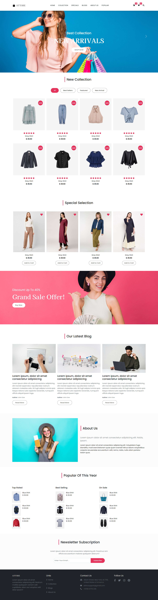

# Attire - Shopping Site

Este projeto é uma landing page de e-commerce de moda, desenvolvida em HTML, CSS, Bootstrap 5 e jQuery. A interface apresenta uma loja de roupas com destaque para coleção, ofertas, produtos em destaque, blog, sobre a empresa e inscrição em newsletter.



## Sobre o projeto

A página foi criada para simular uma loja online moderna, com visual elegante e responsivo, incluindo:

- Hero banner com destaque para novidades e promoções
- Seção de coleção com filtros por categoria
- Produtos em destaque e especiais
- Área de ofertas com desconto promocional
- Blog com artigos da marca
- Seção sobre a loja
- Produtos populares por categoria
- Newsletter para cadastro de e-mail

## Tecnologias utilizadas

- HTML5
- CSS3
- Bootstrap 5
- JavaScript
- jQuery
- Font Awesome

## Estrutura do projeto

```text
shopping-site/
├── index.html
├── css/
│   └── main.css
├── js/
│   ├── jquery-3.6.0.js
│   └── script.js
├── images/
│   ├── layout.png
│   └── ...
├── bootstrap-5.0.2-dist/
│   └── css/
│       └── bootstrap.min.css
└── README.md
```

## Como executar

1. Faça o download ou clone este repositório.
2. Abra o arquivo `index.html` em seu navegador.

Se preferir, também pode iniciar um servidor local:

```bash
python -m http.server 8000
```

Depois acesse:

```text
http://localhost:8000/
```

## Autor

Projeto desenvolvido com foco em layout e experiência visual para uma loja de roupas online.
